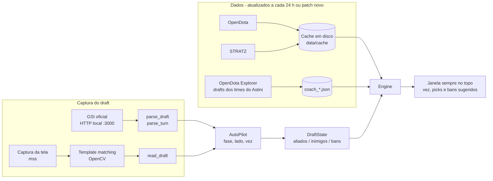

# Dota Draft Assistant

Assistente de draft para Dota 2. Ele acompanha a seleção de heróis em tempo real, seja pela
**leitura da tela** ou pelo **Game State Integration (GSI)** oficial da Valve, e sugere
**counterpicks e bans** com base em quatro fontes:

1. confrontos herói contra herói e sinergias (OpenDota / STRATZ);
2. meta atual por faixa de MMR;
3. presença no cenário profissional;
4. o **perfil de draft de campeonato do coach Filipe "Astini" Astini**.

> Estado: protótipo. O motor de sugestão, o parser do GSI, a leitura de tela, o modo automático
> e a CLI têm testes automatizados com dados de exemplo (`pytest`). As chamadas reais às APIs ainda
> não foram testadas contra os servidores, porque o ambiente onde o código foi escrito não tinha
> acesso a eles. Rode `setup` (ou `update-data`) na sua máquina para validar. A janela do modo
> automático também **não foi aberta num Windows de verdade**: nesse ambiente não havia Tk nem
> Windows, então ela só foi testada com um Tkinter falso.

---

## 1. Fontes de dados

### 1.1 APIs de partidas e estatísticas

| Fonte | O que oferece | Acesso | Uso no projeto |
|---|---|---|---|
| **OpenDota API** (`api.opendota.com/api`) | `/heroStats` (pick/win por faixa 1–8, `pro_pick`/`pro_win`/`pro_ban`, funções, imagens), `/heroes/{id}/matchups`, `/proMatches`, `/live`, `/constants/patch`, `/explorer` (SQL nas tabelas pro: `matches`, `picks_bans`, `teams`) | Gratuita sem chave, com limite por minuto e por dia; chave paga aumenta o limite (veja [opendota.com/api-keys](https://www.opendota.com/api-keys)) | Fonte padrão: meta, presença pro, confrontos e **drafts dos times do Astini** via Explorer |
| **STRATZ GraphQL** (`api.stratz.com/graphql`) | Estatísticas por faixa de MMR com amostras grandes de partidas ranqueadas: `heroStats.heroVsHeroMatchup` (vs e **with** = sinergia), win rate por dia, partidas, ligas | Token Bearer gratuito em [stratz.com/api](https://stratz.com/api) (login pela Steam); exige `User-Agent: STRATZ_API` | Confrontos e sinergias da sua faixa, quando há token |
| **Steam Web API** (Valve) | `IDOTA2Match_570/GetLiveLeagueGames` (drafts de campeonato **ao vivo**), `GetMatchDetails` (`picks_bans`), `GetMatchHistory`, `IEconDOTA2_570/GetHeroes` | Chave gratuita em [steamcommunity.com/dev/apikey](https://steamcommunity.com/dev/apikey) | Acompanhar drafts de campeonato ao vivo; dado oficial de reserva |
| **CDN da Steam** (`cdn.cloudflare.steamstatic.com`) | Retratos e ícones dos heróis (caminhos vêm do `/heroStats`) | Público | Templates da leitura de tela |
| **GRID** (grid.gg) | Dados oficiais de esports em tempo real, incluindo picks e bans durante o draft | Comercial, sob contrato | Opcional, para uso profissional |

### 1.2 Dados do próprio jogo (tempo real)

| Fonte | O que oferece | Limitação |
|---|---|---|
| **Game State Integration** (oficial) | JSON por HTTP local com `draft` (`team2`=Radiant, `team3`=Dire, `pickN_id`, `banN_id`, time ativo), `player`, `hero`, `map` | Configurado por um `.cfg` em `game/dota/cfg/gamestate_integration/` + opção `-gamestateintegration`. Assistindo, ele expõe todos os jogadores; **jogando, só o jogador local**, e o bloco `draft` pode vir vazio em matchmaking |
| **Leitura de tela** (captura + visão computacional) | Funciona em qualquer modo, porque lê os retratos nos slots de pick/ban | Precisa calibrar a posição dos slots uma vez por resolução/HUD |

### 1.3 Meta e referência de campeonato

| Fonte | Uso | Observação |
|---|---|---|
| **Notas de patch oficiais** (dota2.com/patches) e **Liquipedia** (`/dota2/Version`) | Saber qual patch vale e quando ele mudou | O patch atual é lido do `/constants/patch` do OpenDota. Linha 2026: 7.41 em 24/03/2026, depois 7.41a–7.41e (7.41e em 30/07/2026, segundo a Liquipedia); confira se já saiu um patch mais novo |
| **Liquipedia** | Resultados, elencos e drafts de torneios | A API MediaWiki pede User-Agent identificável e tem limite baixo; o LiquipediaDB é pago |
| **Dotabuff, Dota2ProTracker, Datdota, Spectral, tier lists** (esports.gg etc.) | Conferência manual do meta e de builds | Sem API pública; raspar esses sites viola os termos de uso, então ficam fora do código |
| **Dota Plus** (Valve) | Assistente de draft oficial, que sugere heróis pela win rate da sua faixa e considera o draft inimigo | Bom ponto de comparação para as sugestões |

---

## 2. Referência de coach: Filipe "Astini" Astini

O Astini é coach brasileiro: FURIA (2019), B8, **nouns** (top 8 no TI 2023), **Cloud9**
(top 6 no TI 2024), **PARIVISION** (de outubro/2024 até o começo de 2026) e, em 2026, head coach
da **Team Nemesis**, que disputou a EWC 2026. Ex-jogadores dizem que é ele quem monta os drafts
("ele faz nossos drafts", segundo o Gunnar, do nouns), e o estilo dele é conhecido por picks
pouco convencionais.

Como o projeto usa essa referência:

1. `coach-teams <nome>` procura o `team_id` de cada time no OpenDota (vários times têm o mesmo nome; confira pelo último jogo).
2. Você coloca os `team_id` em `config.toml` (`[[coach.stints]]`, com início e fim de cada passagem).
3. `update-coach` baixa pelo Explorer **todos os picks e bans feitos pelo time dele** em cada período e calcula:
   - picks, bans, vitórias com cada herói;
   - prioridade de **primeira fase** (ações entre as primeiras do draft, o que indica herói de prioridade);
   - **decaimento por idade** (meia-vida de 120 dias), para que drafts de patches antigos pesem menos.
4. Essa prioridade entra como o componente `coach` da nota, e a sugestão mostra
   "prioridade nos drafts de Filipe "Astini" Astini" quando o herói é recorrente nos drafts dele.

As datas das passagens em `coach.py` vêm de notícias (GosuGamers, Hawk Live, esports.ru) e
são aproximadas. Ajuste no `config.toml` se souber as datas exatas. Dá para trocar o coach
por qualquer outro editando a seção `[coach]`.

---

## 3. Arquitetura



**Por que cache:** durante o draft você tem cerca de 30 segundos. Por isso `update-data` baixa tudo
antes (heroStats + confrontos de todos os heróis, ~130 chamadas, dentro do limite gratuito) e
o modo ao vivo roda **offline**, sem latência de rede. No modo `auto` essa atualização roda
sozinha em segundo plano, e as sugestões continuam saindo do cache enquanto ela acontece.

### Como a nota é calculada (`scoring.py`)

Cada componente vale pontos percentuais (pp) de win rate:

| Componente | Cálculo |
|---|---|
| `counter` | Soma, para cada inimigo, de quanto o candidato vence acima da própria win rate base. Usa **suavização bayesiana** (`prior_games`), então 3 vitórias em 3 jogos não viram "counter perfeito" |
| `synergy` | O mesmo para os aliados (dados "with" do STRATZ) |
| `meta` | (win rate na faixa − 50%) |
| `pro` | presença pick+ban no pro, normalizada de 0 a 5 |
| `coach` | prioridade nos drafts do Astini, normalizada de 0 a 5 |

`nota = Σ peso × componente`; os pesos ficam em `[weights]`. **Bans** usam a mesma conta
invertida: os heróis que mais counteram os seus picks, somados a meta, pro e coach.

### Módulos

| Arquivo | Responsabilidade |
|---|---|
| `draft_assistant/data_sources.py` | Clientes OpenDota, STRATZ e Steam, cache JSON, controle de taxa e fallback para cache antigo se a rede cair |
| `draft_assistant/scoring.py` | `MatchupTable` e `Engine` (picks, bans, motivos) |
| `draft_assistant/coach.py` | Perfil do Astini, SQL do Explorer, agregação com decaimento |
| `draft_assistant/gsi.py` | Gera o `.cfg`, servidor HTTP local com token, parser do bloco `draft` e da vez (`parse_turn`) |
| `draft_assistant/screen.py` | Captura, calibração dos slots, template matching, recortes para criar templates |
| `draft_assistant/auto.py` | `AutoPilot`: fases do draft pelo `map.game_state`, lado, vez, GSI ou tela como fonte |
| `draft_assistant/ui.py` | Janela sempre no topo (Tkinter) e saída no terminal quando não há Tk |
| `draft_assistant/steam_paths.py` | Acha a pasta do Dota 2 no registro e nas bibliotecas da Steam (`libraryfolders.vdf`) |
| `draft_assistant/autostart.py` | Liga e desliga o início junto com o sistema (`.bat`, `.desktop` ou LaunchAgent) |
| `draft_assistant/cli.py` | Comandos, incluindo `auto`, `setup` e a atualização automática dos dados |

---

## 4. Como usar

### Modo automático (recomendado)

Depois de configurado, você só abre o Dota; o assistente cuida do resto:

1. **Percebe o draft sozinho** pelo GSI (`map.game_state`). A seleção de heróis (`HERO_SELECTION`) e o
   tempo de estratégia (`STRATEGY_TIME`) contam como draft. Quando a partida começa, ele marca o draft
   como encerrado, deixa o draft final na tela e espera o próximo.
2. **Descobre o seu lado** (Radiant ou Dire) pelo `player.team_name` do GSI. `--side` força o lado.
3. **Lê picks e bans do GSI** quando o bloco `draft` vem preenchido (lobbies, Captains Mode, assistindo).
   Em matchmaking esse bloco costuma vir vazio, e então a **leitura de tela** assume; uma leitura só vale
   quando duas capturas seguidas concordam. Se nenhum dado do GSI chegar nos primeiros 20 s (GSI não
   configurado), só a tela é usada.
4. **Mostra uma janela pequena, sempre no topo**, com a vez (`SUA VEZ: PICK (23s)`, `SUA VEZ: BAN`,
   `Vez do adversário`), os heróis já escolhidos e os picks e bans sugeridos. Na sua vez de banir, os
   bans aparecem primeiro. A vez vem do GSI; pela tela o assistente ainda não sabe de quem é a vez.
   Com `--no-gui`, sem Tkinter ou sem tela gráfica, tudo aparece no terminal.
5. **Atualiza os dados sozinho** em segundo plano: quando o cache passa de 24 h ou quando o OpenDota
   mostra um patch diferente do gravado em `data/state.json` (ele confere de hora em hora). Sem
   internet, só avisa e continua com o cache. Na primeira vez, sem cache nenhum, ele baixa tudo antes de abrir.
6. **Abre junto com o Windows**, se você quiser (`autostart-on`): grava um `.bat` na pasta Inicializar
   do usuário (no Linux, um `.desktop` em `~/.config/autostart`; no macOS, um LaunchAgent).

Começo rápido:

```bash
pip install -r requirements.txt
python -m draft_assistant setup          # dados + retratos, acha o Dota e grava o GSI (sem perguntas)
python -m draft_assistant calibrate      # numa tela de draft: marque os slots de pick/ban com o mouse
python -m draft_assistant autostart-on   # opcional: abrir junto com o Windows (autostart-off desliga)
python -m draft_assistant auto           # ou só: python -m draft_assistant
```

O `setup` mostra também como colocar `-gamestateintegration` nas opções de inicialização do Dota 2 na
Steam. Esse passo é manual, porque o assistente não mexe na configuração da Steam. Se ele não achar a
pasta do Dota, use `gsi-config --dota-dir "<pasta>\steamapps\common\dota 2 beta"`.

Opções do `auto`: `--no-gui`, `--side radiant|dire`, `--port 3000`, `--token T`, `--role Support`,
`--top 6`, `--interval 1.0` (segundos entre capturas da tela) e `--no-refresh` (não baixa nada, só usa o
cache). `role` e `top` também podem ficar na seção `[auto]` do `config.toml`, que é o que vale quando o
assistente abre junto com o sistema. Para sair, feche a janela ou aperte Ctrl+C.

A janela fica por cima do jogo quando o Dota roda em **janela sem bordas**; em tela cheia exclusiva o
jogo a cobre, então use um segundo monitor. Ela guarda tamanho e posição em `data/window.json`.

> A janela e o início automático só foram testados com testes automáticos (com um Tkinter falso), não num
> Windows de verdade. Se algo aparecer errado (texto borrado, janela atrás do jogo, nada abrindo no login),
> rode `python -m draft_assistant auto` num terminal para ver os avisos.

### Comandos avulsos

```bash
pip install -r requirements.txt
cp config.example.toml config.toml        # opcional: STRATZ token, faixa, pesos, team_ids

python -m draft_assistant update-data --templates   # baixa dados e retratos (uma vez por dia)
python -m draft_assistant coach-teams nemesis       # descobre o team_id da Team Nemesis
python -m draft_assistant update-coach              # baixa os drafts dos times do Astini

# Draft digitado à mão
python -m draft_assistant suggest --enemies "am,axe,cm" --allies "bane" --role Carry
```

### Ao vivo pela tela (funciona em qualquer modo)

```bash
python -m draft_assistant calibrate --side radiant   # numa tela de draft: marque os slots com o mouse
python -m draft_assistant watch --source screen --side radiant
```

Se algum herói não for reconhecido (a arte do slot pode ser diferente do retrato do CDN), rode
`calibrate --save-crops` durante um draft, renomeie os recortes para `<hero_id>_<nome>.png`
e coloque em `data/templates/`. Eles passam a servir de template junto dos oficiais.

### Ao vivo pelo GSI (assistindo partidas, lobbies e Captains Mode)

```bash
python -m draft_assistant gsi-config   # acha a pasta do Dota sozinho; ou --dota-dir "...\dota 2 beta"
# Steam > Dota 2 > Propriedades > Opções de inicialização: -gamestateintegration
python -m draft_assistant watch --source gsi
```

O `gsi-config` grava o token em `data/state.json`, e o `auto` e o `watch` passam a usá-lo sozinhos.

Deixe a janela do assistente num segundo monitor ou em outra janela ao lado do jogo.

---

## 5. Fair play

- **A automação nunca joga por você.** "Automático" quer dizer só que o assistente percebe sozinho quando
  o draft começa, de que lado você está, de quem é a vez e quando atualizar os dados. Ele **não clica, não
  digita, não escolhe nem bane herói** e não envia nenhum comando ao jogo: quem escolhe é sempre você.
  Automatizar a entrada do jogo (cliques, teclas, macros) quebra as regras da Valve e pode render ban da conta.
- O assistente **só lê** a tela (pixels, como uma gravação) ou o GSI oficial: não lê a memória do jogo e não
  injeta nada no processo do Dota. A janela de sugestões é uma janela comum do sistema, sempre no topo; ela não
  desenha dentro do jogo.
- Ele não consulta o histórico dos jogadores adversários. Foi esse tipo de recurso, oferecido por um app do Overwolf, que a comunidade tratou como trapaça e que a Valve bloqueou no pré-jogo.
- A Valve já oferece sugestão de herói no Dota Plus. Esta ferramenta faz o mesmo tipo de análise com fontes abertas e uma referência de campeonato.

---

## 6. Próximos passos

- [ ] Validar as consultas reais (OpenDota, STRATZ) e ajustar campos do GraphQL por introspecção.
- [ ] Recomendação por **posição** (1–5) usando lane/role do STRATZ, em vez das funções genéricas.
- [x] Ler a ordem do draft (quem escolhe agora) para alternar entre sugerir picks e bans (pelo GSI).
- [ ] Ler de quem é a vez também pela tela, para o matchmaking em que o GSI não traz o draft.
- [x] Interface gráfica simples (Tkinter), sempre no topo, com o terminal como reserva.
- [x] Modo automático: detectar draft e lado, atualizar dados a cada 24 h ou patch novo, abrir com o sistema.
- [ ] Testar a janela e o início automático num Windows de verdade (Tk, escala de tela, `.bat` na pasta Inicializar).
- [ ] Baixar sozinho os retratos de heróis novos depois de um patch (hoje: `update-data --templates` e reiniciar).
- [ ] Acompanhar drafts de campeonato ao vivo (`GetLiveLeagueGames`) e comparar com as escolhas do Astini.

## Testes

```bash
pip install pytest
python -m pytest
```

## Fontes consultadas

- OpenDota: [mudanças na API (blog)](https://blog.opendota.com/2018/04/17/changes-to-the-api/)
- STRATZ: [stratz.com](https://stratz.com/), [wrapper MCP com exemplos de GraphQL](https://github.com/pipeworx-io/mcp-stratz), [metodologia de counters com dados do STRATZ](https://www.dota2protips.com/methodology/heroes)
- GSI: [dota2-gsi (npm)](https://www.npmjs.com/package/dota2-gsi), [Dota2GSI (NuGet)](https://www.nuget.org/packages/Dota2GSI)
- GRID: [grid.gg/data/games/dota-2](https://grid.gg/data/games/dota-2/)
- Patches: [Liquipedia: Game Versions](https://liquipedia.net/dota2/Game_Versions), [Liquipedia: 7.41e](https://liquipedia.net/dota2/7.41e)
- Meta: [esports.gg: tier list](https://esports.gg/news/dota-2/dota-2-hero-tier-list/)
- Dota Plus e Overwolf: [esports.gg](https://esports.gg/opinion/dota-2/is-dota-plus-pay-to-win-every-paid-dota-2-feature-explained)
- Astini: [GosuGamers: Team Nemesis anuncia Astini](https://www.gosugamers.net/dota2/news/78371-team-nemesis-overhaul-dota-2-roster-appoint-astini-as-head-coach-ahead-of-ewc-and-ti-2026), [GosuGamers: saída da PARIVISION](https://www.gosugamers.net/dota2/news/77670-parivision-coach-astini-departs-lineup-ahead-of-dreamleague-season-27), [entrevista no TI 2024](https://www.gosugamers.net/dota2/features/73072-astini-interview-at-ti-2024-sometimes-being-skilled-comes-with-wanting-to-freestyle-too-much), [nouns no TI 2023](https://nordot.app/1090696791189619055), [esports.ru: balanço da EWC 2026](https://esports.ru/dota-2/news/astini-podvel-itogi-vystupleniya-na-ewc2026/)
